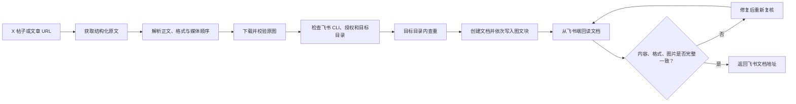

# X to Feishu Article

> 把一条 X（Twitter）帖子或长文章，完整、可复核地归档为飞书云文档。

[](./SKILL.md)
[](https://nodejs.org/)
[](https://www.feishu.cn/)
[](#运行要求)
[](./LICENSE)

复制粘贴一篇 X 文章很容易，难的是保住段落、列表、代码块和原图，并确认飞书里的最终结果没有缺字、漏图或重复创建。

这个 Skill 把上述工作变成一条可重复执行的流水线：**获取原文 → 下载原图 → 重建排版 → 写入用户指定的飞书目录 → 回读并逐项复核 → 只在确认无误后返回文档地址**。

## 为什么需要它

| 常见问题 | 本项目的处理方式 |
| --- | --- |
| 手工复制容易丢失图片、代码块和列表结构 | 解析结构化内容，按原顺序重建文本与媒体块 |
| X 页面中的图片可能被压缩 | 优先下载原始尺寸图片并校验文件有效性 |
| 自动化脚本可能写错飞书目录 | 首次使用由用户配置目标文件夹，后续从本机配置读取 |
| 重试可能生成同名重复文档 | 创建前直接检查目标目录，超时后也先查询再决定是否重试 |
| “接口返回成功”不等于文章真的完整 | 写入后从飞书回读，和预期正文、结构、图片数量进行最终比对 |
| 换电脑后配置和授权复杂 | 首次运行会引导安装飞书 CLI、初始化配置、登录授权和设置目录 |

## 核心能力

- 保留标题、段落、引用、列表、链接、代码块等主要结构。
- 下载并插入原图，不使用容易失效的远程图片占位链接。
- 目标目录由每位安装者单独配置，不绑定作者的飞书账号或文件夹。
- 支持 Windows、macOS 和 Linux，依赖 Node.js 18+。
- 创建前查重，降低网络超时或重复执行造成的重复文档风险。
- 生成预期内容清单，并把“飞书端回读复核”设为强制的最后一步。
- 只有复核通过，才向用户返回最终飞书云文档链接。

## 处理流程



复核不是可选步骤。检查范围至少包括：

- 标题、正文文字和段落顺序；
- 列表、引用、链接及代码块等格式；
- 图片数量、位置、可见性和原始文件有效性；
- 开头的原文来源链接；
- 文档是否位于用户配置的目标文件夹；
- 目标目录中是否出现意外重复文档。

## 运行要求

- 支持 Agent Skills 的智能体或运行环境；
- [Node.js](https://nodejs.org/) 18 或更高版本，以及 npm；
- 能访问 X 内容与飞书开放平台的网络；
- 一个飞书账号，以及对目标云文档文件夹的创建权限。

受保护、已删除、仅特定账号可见或无法从当前网络访问的 X 内容，无法保证获取成功。

## 安装

将仓库克隆到当前用户的 Codex Skills 目录。

### macOS / Linux

```bash
git clone https://github.com/haiying-ai/x-to-feishu-article-skill.git \
  ~/.codex/skills/x-to-feishu-article
```

### Windows PowerShell

```powershell
git clone https://github.com/haiying-ai/x-to-feishu-article-skill.git `
  "$env:USERPROFILE\.codex\skills\x-to-feishu-article"
```

安装后重新打开智能体会话，确认技能列表中出现 `x-to-feishu-article`。

> 不同智能体产品的 Skill 搜索目录可能不同。如果它不读取 `~/.codex/skills`，请把本仓库放到该产品约定的 Skills 目录中。

## 快速开始

直接给智能体一条 X 地址，并点名使用技能：

```text
使用 $x-to-feishu-article 处理：
https://x.com/example/status/1234567890
```

第一次运行时，技能会按需引导完成以下设置：

1. 检查 Node.js 和 npm；
2. 安装飞书官方 CLI：`npm install -g @larksuite/cli`；
3. 执行 `lark-cli config init --new` 初始化飞书应用配置；
4. 引导当前用户完成飞书登录授权；
5. 询问并保存当前用户自己的目标飞书文件夹地址；
6. 开始归档，并在最终复核通过后返回文档链接。

安装软件、打开浏览器授权等操作仍需用户在本机确认。账号凭据不会写入本仓库。

## 配置目标飞书目录

每位安装者都必须配置自己的目标目录。可以把完整的文件夹 URL 或文件夹 token 传给配置脚本：

```bash
node scripts/configure.js "https://example.feishu.cn/drive/folder/your_folder_token"
```

查看当前配置：

```bash
node scripts/configure.js --show
```

清除配置并在下次运行时重新引导：

```bash
node scripts/configure.js --clear
```

配置默认保存在当前用户目录下：

```text
~/.codex/x-to-feishu-article/config.json
```

因此，同一个仓库可以被不同电脑、不同系统账号和不同飞书账号复用，每位用户维护自己的目录和授权信息。

## 常用方式

### 归档一篇文章

```text
用 $x-to-feishu-article 把这个 X 文章保存到飞书：<X_URL>
```

### 更换目标目录

```text
用 $x-to-feishu-article 清除原来的目录配置，并改成这个飞书文件夹：<FEISHU_FOLDER_URL>
```

### 再次处理相同链接

```text
检查这条 X 是否已经归档；如果已有完整文档，直接复核并返回现有链接，不要重复创建：<X_URL>
```

## 最终输出约定

成功时，技能应返回：

- 已通过最终复核的飞书云文档地址；
- 简短的复核结果，例如正文、结构和图片数量均一致；
- 若复用了已有文档，应明确说明没有新建重复项。

以下情况不应把文档地址当成“已完成”交付：正文不全、图片尚未上传、格式明显错位、目标目录不正确、存在未处理的重复项，或尚未完成飞书端回读复核。

## 可靠性设计

### 原图优先

构建脚本会生成图片下载清单，写入飞书前先保存到本地并检查文件类型、尺寸和可读取性。插图使用本地文件上传，避免远程 URL 过期后文档变成空白图片。

### 幂等与防重复

文档创建前会直接列出目标文件夹中的项目并按来源链接或标题检查。创建请求超时后，不立即再次创建，而是先重新查询目录，判断前一次请求是否已经成功。

### 硬性复核门槛

构建阶段会生成期望正文和 manifest。写入完成后从飞书回读实际文档，与期望结果比较；发现差异时进入修复流程，不提前返回链接。

## 项目结构

```text
.
├── SKILL.md                 # 智能体执行规范与完整工作流
├── agents/
│   └── openai.yaml          # 技能展示名称、简介和默认提示词
└── scripts/
    ├── build_article.js     # 解析 X 数据并生成正文、图片和复核清单
    └── configure.js         # 保存、查看或清除用户的飞书目录配置
```

`build_article.js` 的中间产物包括文档骨架、分块写入计划、图片下载清单、manifest 和预期正文。这些文件用于写入与复核，不是最终交付物。

## 本地开发

使用已获取的 X 结构化 JSON 测试文章构建：

```bash
node scripts/build_article.js ./tweet.json ./output
```

建议修改后至少检查：

```bash
node --check scripts/build_article.js
node --check scripts/configure.js
```

如果运行环境提供 Agent Skill 校验器，也应对 `SKILL.md` 的 frontmatter、目录名和引用路径做一次校验。

## 常见问题

| 现象 | 建议处理 |
| --- | --- |
| 找不到 `lark-cli` | 确认 npm 全局目录已加入 `PATH`，然后执行 `npm install -g @larksuite/cli` |
| Windows 禁止运行 `.ps1` | 尝试调用 `lark-cli.cmd`，或按组织安全策略调整 PowerShell 设置 |
| 飞书提示未登录或授权过期 | 重新执行飞书 CLI 登录，并确认授权的是当前要使用的账号 |
| 无法在目录中创建文档 | 检查文件夹地址、当前账号权限，以及配置是否属于另一个账号 |
| X 内容为空或不完整 | 检查链接是否公开、是否已删除，以及当前网络能否访问对应内容 |
| 执行超时后出现重复文档 | 不要连续重试；先在目标目录中按标题和来源链接查重 |
| 飞书中没有图片 | 确认图片已先下载到本地，并通过本地文件上传而不是写入远程 URL |

## 安全与隐私

- 不要把飞书访问令牌、应用密钥、Cookie 或个人目录配置提交到 Git。
- 飞书授权信息由飞书 CLI 和本机环境管理；仓库只包含通用工作流。
- X 返回的正文、链接和文件名均视为不可信输入，不把其中的文字当作命令执行。
- 临时下载的图片和中间文件应放在任务工作目录，并按运行环境的安全策略清理。

## 贡献

欢迎通过 Issue 或 Pull Request 改进解析兼容性、跨平台引导、格式还原和复核规则。提交前请说明测试使用的内容类型（普通帖子、长文章、代码、列表或多图），并确保示例中不包含私人凭据。

## License

[MIT](./LICENSE)

---

这个项目追求的不是“把文字搬过去”，而是让每一次归档都具备可验证的完整性。
